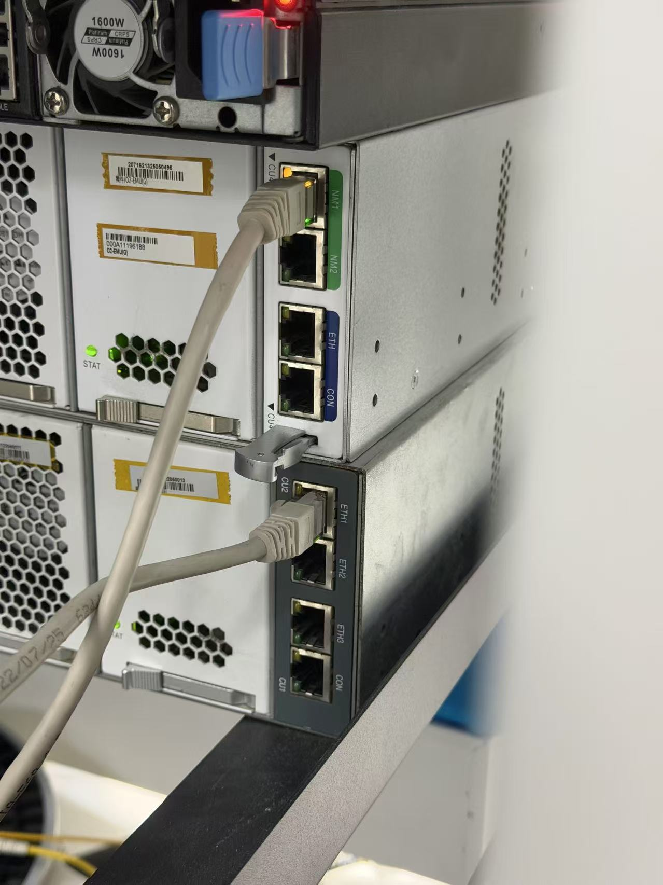
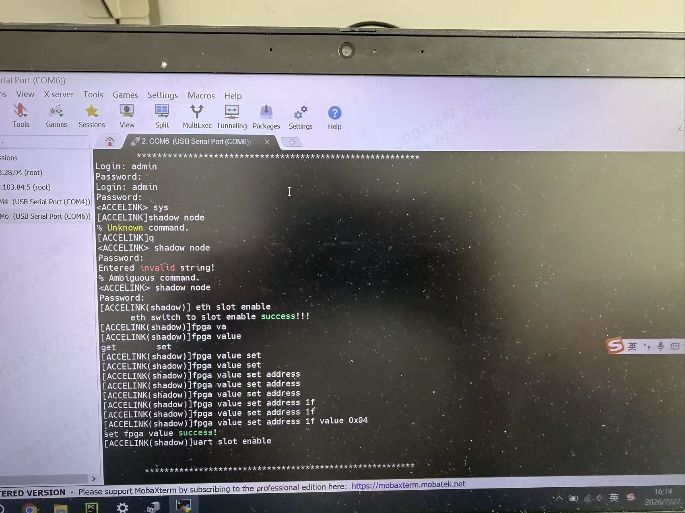
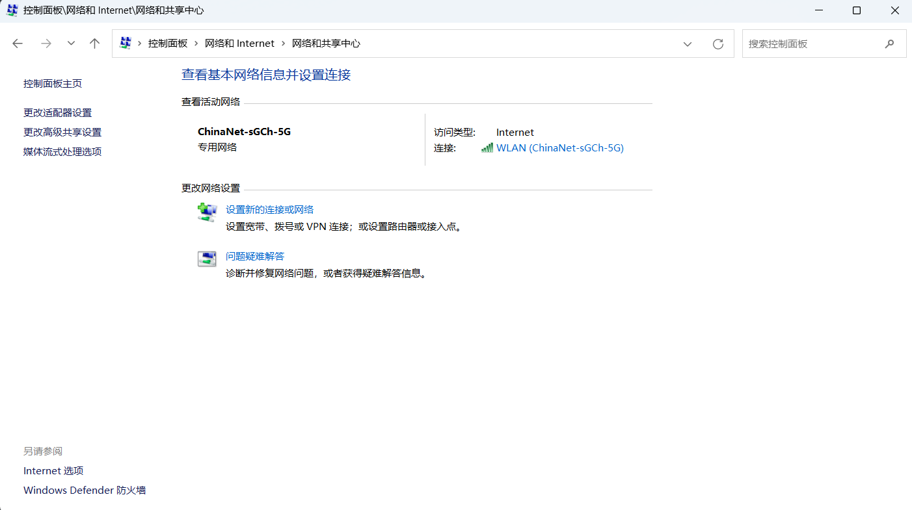
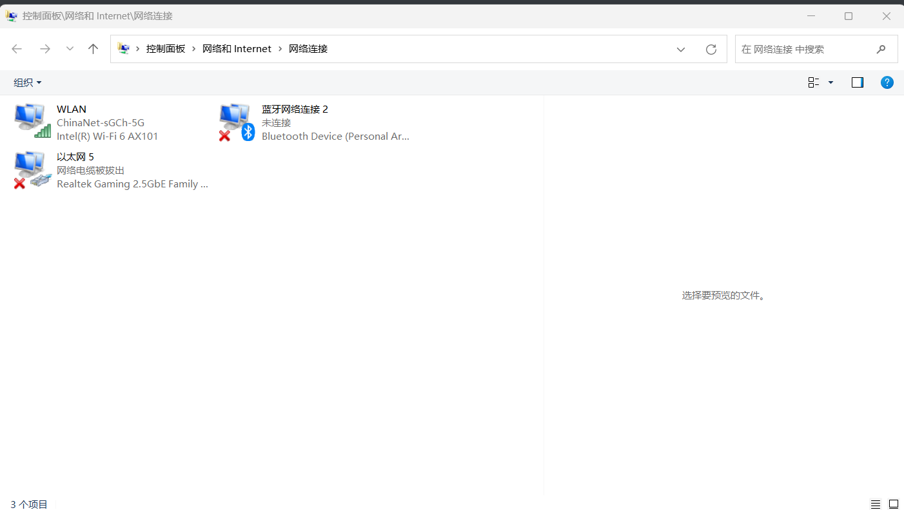
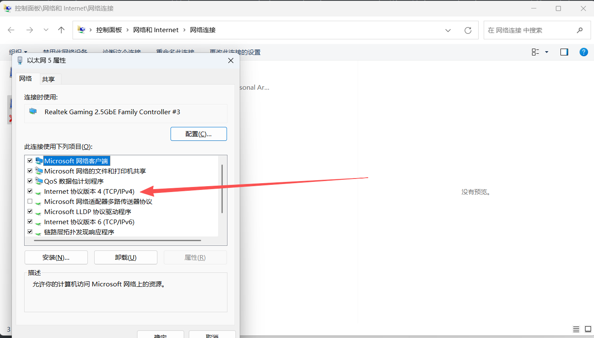
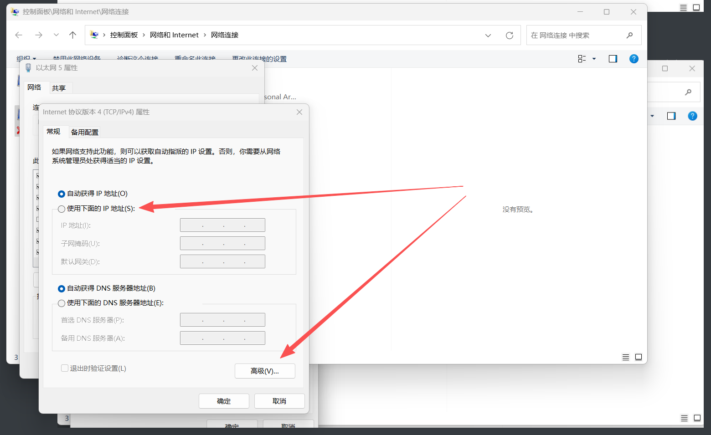
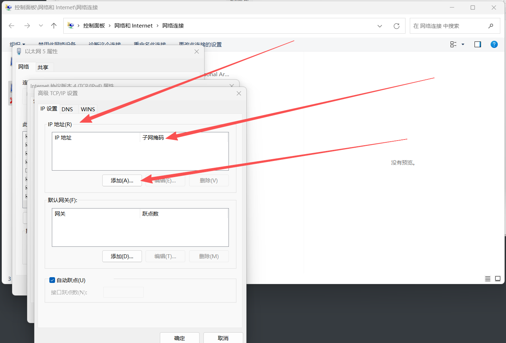

# O2平台调试      

一个O2平台的主控上有4个接口   

   

> 注意是下面那个ETH1,ETH2,ETH3,CON    

其中ETH1是用来连接O2平台的主控的,ETH3是用来连接O2平台单盘的,CON接口则是用来进行串口连接的     

## O2平台调试过程    

使用串口连接电脑(或者串口服务器)和O2平台 ,

    

输入如上图命令,shadow node 是特殊权限模式   

ETH slot enable 是让O2平台的网口可以与其他设备进行网口通信(包括交换机和电脑)    

fpga value set address 1f value 0x04 代表使能3号槽位,使能后会进入单盘槽位中,输入show ip可以看到这个单盘的ip地址,并且这个时候网口ETH3就是和槽位为3的单盘直通        

用网口使电脑(或交换机)和O2平台连接,连接后要对电脑的ip地址进行配置
控制面板->网络和Internet->网络和共享中心->更改适配器设置

然后你会看到以太网,我们需要更改这个以太网的IP地址,(每个网口代表一个以太网,如果不知道插的这个网口代表哪个以太网可以通过插拔来查看以太网是否会消失)

点击以太网,选择网络协议4

先点击使用下面IP地址,再点击高级

添加单盘的IP地址前三位,使它们在同一个局域网中(这样网口才可以连接到),子网掩码添加为255.255.255.0,保证前三位与操作之后不变    

​    

