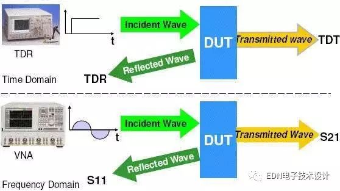
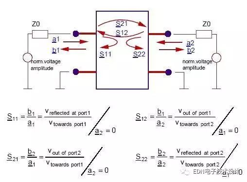
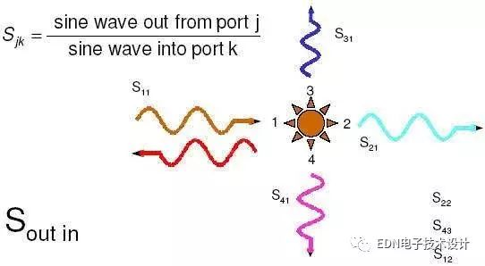
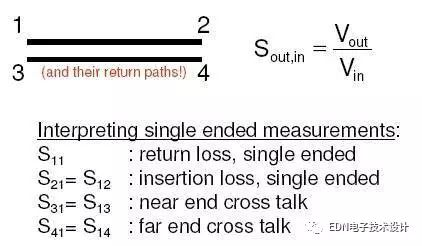
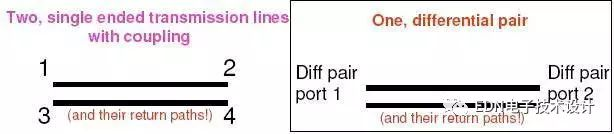
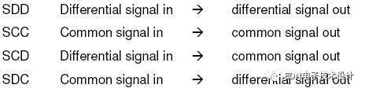
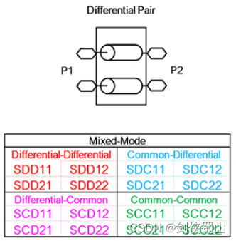
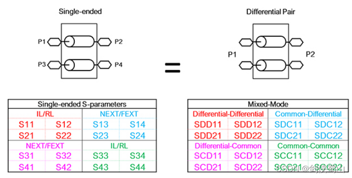
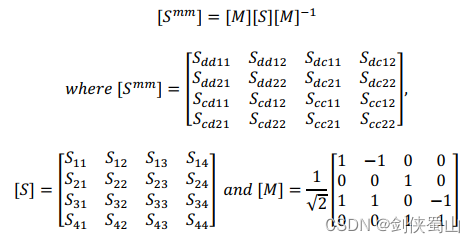
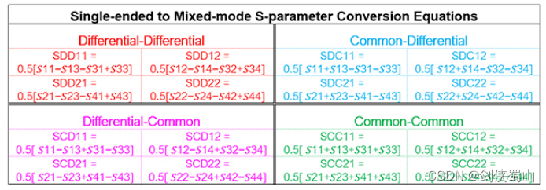

# S参数介绍   
S参数测量是射频设计过程中的基本手段之一。S参数将元件描述成一个黑盒子，并被用来模拟电子元件在不同频率下的行为。在有源和无源电路设计和分析中经常会用到S参数。

从时域与频域评估传输线特性

看一条线的特性：S11、S21

看两条线的相互关系：S31、S41

看不同模式的讯号成份：SDD、SCC、SCD、SDC

   

良好的传输线，讯号从一个点传送到另一点的失真(扭曲)，必须在一个可接受的程度内。而如何去衡量传输线互连对讯号的影响，可分别从时域与频域的角度观察

而所谓的S参数即是频域特性的观察，其中"S"意指"Scatter"(散射)，与Y或Z参数，同属双端口网络系统的参数表示

S参数是在传输线两端有终端的条件下定义出来的，一般这Zo=50奥姆，因为VNA port也是50奥姆终端。所以，reference impedance of port的定义不同时，S参数值也不同，即S参数是基于一指定的port Zo条件下所得到的。

## 看一条线的特性   

看一条线的特性：S11、S21
如下图所示，假设port1是讯号输入端，port2是讯号输出端

S11表示在port 1量反射损失(return loss)，主要是观测发送端看到多大的的讯号反射成份；值越接近0越好(越低越好 ，一般-25~-40dB)，表示传递过程反射(reflection)越小，也称为输入反射系数(Input Reflection Coefficient)。
S21表示讯号从port 1传递到port 2过程的馈入损失(insertion loss)，主要是观测接收端的讯号剩多少；值越接近1越好(0dB)，表示传递过程损失(loss)越小，也称为顺向穿透系数(Forward Transmission Coefficient)。

## 看两条线的相互关系   

虽然没有硬性规定1、2、3、4分别要标示在线哪一端，但[Eric Bogatin大师]建议奇数端放左边，且一般表示两条线以上cross-talk交互影响时，才会用到S31。以上图为例，S31意指Near End Cross-talk (NEXT)，S41意指Far End Cross-talk (FEXT).

## **看不同模式的讯号成份：SDD、SCC、SCD、SDC**   

**看不同模式的讯号成份：SDD、SCC、SCD、SDC**

差分（Differential）S参数又叫混模（Mixed-Mode）S参数、均衡（Balanced）S参数。差分S参数主要描述的是差分端口的回损（RL）、插损（IL）、模态转换损耗等。

其中，Differential-Differential、Common-Common两个矩阵比较好理解。

SDDnn代表从portn输入又从portn输出的差分信号，即portn的差分回波损耗，如SDD11代表从port1输入、从port1输出的差分信号，也即是port1的差分回波损耗；
SCCnn代表从portn输入又从portn输出的共模信号，即portn的共模回波损耗，如SCC11代表从port1输入、从port1输出的共模信号，也即是port1的共模回波损耗；
SDDnm代表从portm输入，从portn输出的差分信号，即portm到portn的差分插入损耗，如SDD12代表从port2输入、从port1输出的差分信号，即port2到port1的差分插入损耗；
SCCnm代表从portm输入，从portn输出的共模信号，即portm到portn的共模插入损耗，如SCC12代表从port2输入、从port1输出的共模信号，即port2到port1的共模插入损耗；
另外两个矩阵Common-Differential、Differential-Common则代表模态转换，以Common-Differential矩阵为例：
SDC11代表从port1输入差分信号，在port1接收到的共模信号；
SDC12代表从Port2输入差分信号，在Port1接收到的共模信号；
SDC21代表从port1输入差分信号，在port2接收到的共模信号；
SDC22代表从port2输入差分信号，在port2接收到的共模信号；
通过差分S参数矩阵，可以将差分信号的传输特性完整描述出来。   

> 注意区分差分信号是在物理层面还是信号层面   
>
> - **物理上差分信号指两条线**：差分信号通常通过**两条物理导线**（双绞线）来传输。
> - **电气上（本质）**：它传输的是**一个信号**，只不过这个信号是用**两条线上电压的差值**来表示的    
>
> **差分信号**和**共模信号**其实**不是并列的两种信号类型**，而是**同一对传输线上同时存在的两个“分量”**。   
>
> ### 数学定义（一眼看懂）
>
> 假设一对差分线，线A的电压是 V+，线B的电压是 V−：
>
> - **差分信号（差模电压）**：VDM=V+−V−
>   - *这是接收端真正要读的有用信息。*
> - **共模信号（共模电压）**：VCM=(V++V−)/2
>   - *这是两条线上**同时**出现的那部分电压（平均值），通常是有害的。*
>
> 

## 单端S参数与差分S参数的转化

差分S参数在本质上来说，就是4端口网络，与单端4端口网络实际上是等价的，通过两种S参数都可以完整的描述4端口网络，所以，二者对于同一个4端口网络的描述时等价的，相互之间时可以相互转化的。

**实上，所有的仪器都只能测量单端S参数，仿真软件也都是以单端S参数为仿真基础。所以，无论是仪器测量还是软件仿真，在仿真差分S参数时，都是先仿真出单端S参数，再转化为差分S参数的。**
单端S参数通过一个矩阵变换转化为差分S参数，公式为：

## S参数的大小相关    

问题:为何有时候会遇到每一段的S参数个别看都还好，但串起来却很差的情况(loss不是1+1=2的趋势)?

Quick answer : 如果每一线段彼此连接处的real port Zo是匹配的，那loss会是累加的趋势，但若每一线段彼此连接处的real port Zo差异很大，那就会看到loss不是累加的趋势，因为串接的接面上会有多增加的反射损失。