# 传输线   

所谓的传输线只不过是考虑了**寄生参数**的普通模拟电路,为什么需要传输线理论

先说一句非常关键的话：

**所有信号本质上都是电磁波在传播。只是有些情况下，我们可以忽略传播过程**。

在 PCB 上，信号传播速度大约是光速的 1/2 左右，数量级上可以记成：≈ 15 cm / ns

举个直观例子：

一条 10 cm 的走线，传播时间大约是：10 ÷ 15 ≈ 0.67 ns

现在看两种情况。

**情况一：低速信号（上升沿很慢）**

假设上升沿是 100 ns。

那 0.67 ns 相对于 100 ns 几乎可以忽略。

在电压慢慢变化的过程中，信号已经在线上来回传播多次，

于是你看到的效果就像：**整根线几乎“同时变化”**。

这就是我们熟悉的“[集中参数模型](https://zhida.zhihu.com/search?content_id=772299447&content_type=Answer&match_order=1&q=集中参数模型&zhida_source=entity)”：走线可以近似当作一根理想导线。

**情况二：高速信号（上升沿很快）**

如果上升沿是 1 ns。那 0.67 ns 就不能忽略了。

会发生什么？

- 近端已经开始上升
- 远端还没来得及响应
- 波传播到末端
- 如果阻抗不匹配，就会发生反射
- 反射波叠加回来
- 产生振铃、过冲、抖动

这就是“信号完整性问题”的来源。

所以高速设计的本质是：

**传播时间与上升沿同量级时，反射和回流路径开始主导波形**。

# 寄生参数   

## 电感、传输线和寄生电感    

首先要进行介绍的是电感是一个什么东西：**电感是导体抵抗流过它的电流变化的现象，电感的定义是感应电压与引起感应电压的电流变化率之比。**      

电感是闭合回路的一种属性，是一个物理量。当电流通过线圈后，在线圈中形成磁场感应，感应磁场又会产生感应电动势来抵制通过线圈中的电流。这种电流与线圈的相互作用关系称为电的感抗，也就是电感      
$$
V = L\frac{dI}{dt}
$$
还有一个电感定义式，**自感系数L**，也被称为电感或自感(**自感**：回路中电流 I*I* 产生的磁通量，反过来匝链这个回路本身；)
$$
L = \frac {\Psi}{I},         
其中\Psi为磁通量,I为电流,L为电感
$$

 **磁通量（Φ）是描述磁场穿过某一特定面积的总量的物理量，其大小取决于磁场强度、面积大小及两者的相对方向。**

$$
\Psi = \int B \  ds
$$
B为磁感应强度,可以类比于电感应强度

​    

**那么为何,传输线会有寄生电感呢**   

我们对一条传输线的局部来进行分析   

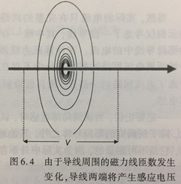 

由毕奥-萨伐尔定律可知,电流流过导线，会在导线的周围产生磁场。

麦克斯韦方程组可知,当电流发生变化的时候,磁场也会跟随变化

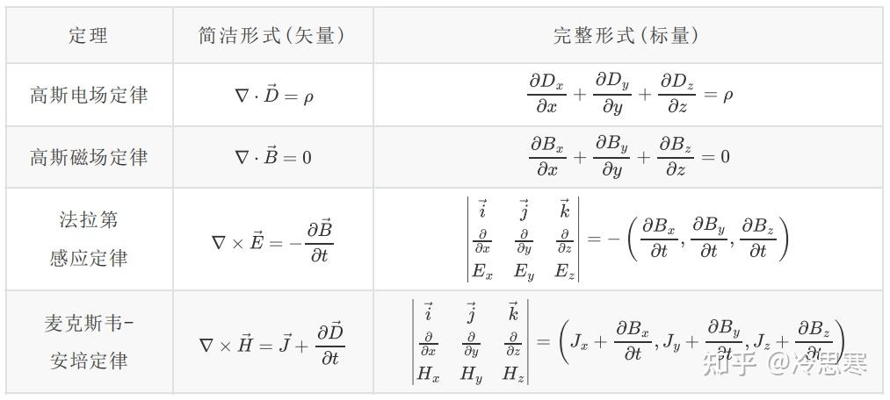 

变化的磁场又会产生电场,电场的方向为

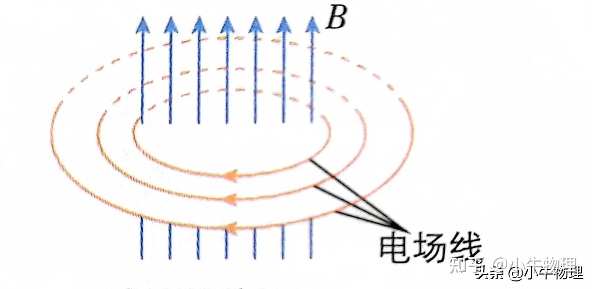

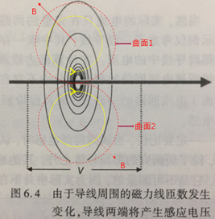

这个电场将阻碍电流的变化，而阻碍电流变化的这种能力，就可以理解为电感，因为导线是回路的一部分，所以这部分电感称之为局部电感。   

这就是传输线的寄生电感

自感的计算：

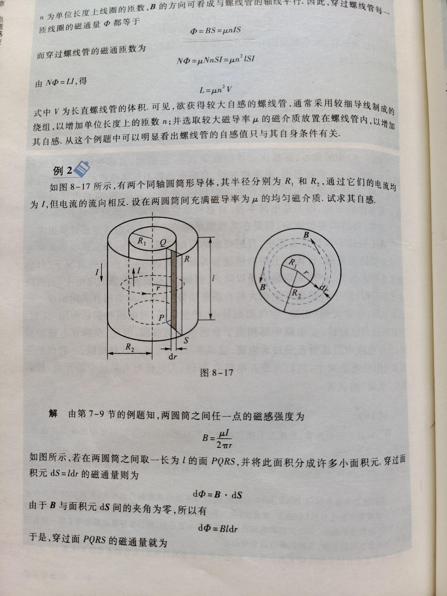  

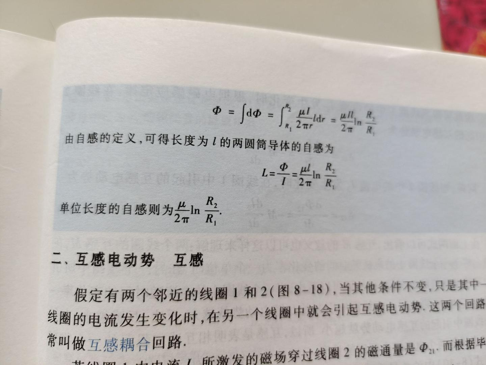

## 电容、传输线和寄生电容    

寄生电容的形成那就很简单了：

每根传输线都有信号路径和返回路径，信号路径通常接芯片的输出端（正极），返回路径通常接芯片的GND端（负极）       

通常来说两个导体，中间再加上绝缘介质，那就是一个电容器，  

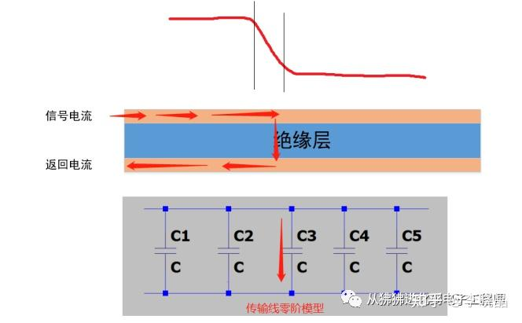

当信号加到传输线上时，第一个电容两端的电压发生变化，电流流过第一个电容，即有电流流入电容的正极，同时有电流从电容的负极流出从返回路径回到源端。此时信号还没到第二个及更远的电容处，因此传输线后续的结构，信号是不知道的。因此时的返回电流仅与信号变化（上升沿）对应的那一小段传输线和瞬时环境有关。

## 传输线的寄生电阻   

传输线的寄生电阻主要是由于电流的趋肤效应造成的       

趋肤效应，又称为集肤效应，是指在交流电或交变电磁场作用下，导体内部的电流分布不均匀的现象。

***在电学中，交流高频电流趋向于聚集在导电材料表面的趋势。这种现象将电流限制在总横截面积的一小部分，因此具有增加导体电阻的效果。由于趋肤效应，感应加热可以局限于表面，加热区域可以通过选择合适的电感线圈来控制（参见感应加热）。频率越高，趋肤效应就越明显。\***   

在电路中，由于电源的作用，载流子（通常是电子）受到电场的驱动定向运动。电流会在导体中产生磁场，导体中电流强度变化时磁场也会变化。变化的磁场会产生环路电场，这个电场又会驱动电流。这个电场在导线边缘处方向趋向于与电流方向相同，在导线内部趋向于与电流方向相反，从而导致电流密度集中在导体表面。

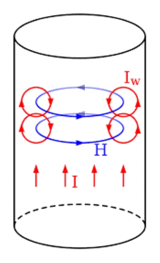

## 传输线的寄生电导      

寄生电导：是“导体之间绝缘路径”不理想产生的等效电导   

介电现象（dielectric phenomenon）是指对绝缘材料施加电压时，材料内部产生正、负电荷分离的现象，   

实际绝缘材料不是完美绝缘体，内部存在少量自由离子、电子、空穴、杂质和缺陷。当导体之间加电压时，这些载流子在电场作用下定向迁移，形成微小传导电流，宏观上就是漏电流。这个漏电流路径等效为并联电导 G*G*。直流或低频下，G*G* 主要来自这种绝缘电阻有限的漏电。

寄生电导
本质：介质损耗的等效电路表征。在电容模型或传输线模型中，表现为并联在电容两端的电导。

物理根源：介质极化弛豫。高频交变电场下，电介质内部的偶极子或电荷载流子无法瞬时响应，产生摩擦和热量，消耗能量。    

交流电压下，绝缘介质中的极性分子、偶极子、离子等会随电场反复取向和迁移。如果电场变化太快，极化跟不上，就会产生滞后和摩擦式能量损耗，变成热量。这种损耗在电路上等效为并联电导。频率越高，这种损耗通常越明显。

关键参数：损耗角正切。它表征了介质中损耗功率与存储功率之比。tanδ = ε''/ε'，其中ε‘’是介电常数虚部（损耗），ε‘是实部（储能）。

影响：信号衰减、发热、降低滤波器Q值、限制高频性能。是射频微波电路中，选择PCB基材的核心指标。

## 传输线的等效模型        

考虑到寄生电感和寄生电容的影响,一个传输线的等效模型是这样的

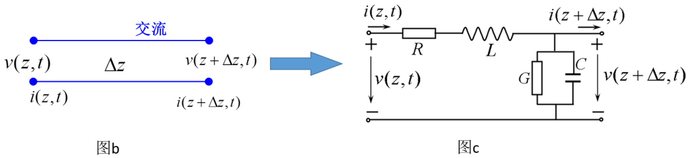

# 传输线上的信号传播   

传输线上的信号传播是依靠电磁场来传播的，**所有信号本质上都是电磁波在传播。**   

电子速度与[电流速度](https://zhida.zhihu.com/search?content_id=105976569&content_type=Answer&match_order=1&q=电流速度&zhida_source=entity)没有本质关系。

**光速指的是电场建立的速度。**当整个导体里建立了电场后，所有电子同时行进产生电流，**和电子速度有关的是电流大小。两者**并没有本质上的关系。

有必要提到电场线这个模型。

场有载体，载体以光速传播，并与场内的物质相互作用使电子受力。由于我们并不知道载体是什么，所以建立了电场线的模型。

所以，不严格的说，实际上是电势差——电场——电场力——电子运动——电流（电势差和电场顺序不定）。其中，电场建立的速度是电流的速度，电子运动的速度只关乎电流大小。

电磁场的传播并不需要介质，之所以沿着导线的方向传播是有原因的

- **自由空间传播（天线模式）**：当电磁波不受约束时，它是以**球面波**的形式向四面八方扩散的。能量随着距离的平方衰减（1/r平方）。如果你在PCB上不用导线，直接把信号源和接收端靠近，信号能量会向整个空间辐射，接收端只能收到极其微弱的一部分，绝大部分能量变成了EMI（电磁干扰）浪费掉了。
- **导行传播（传输线模式）**：当电磁波遇到导体时，导体表面的自由电子会受场驱动重新分布。信号线与参考平面（GND/POWER）构成了一个**“波导”结构**。电磁场被“束缚”在两根导体之间的狭窄空间里，沿着导体向前推进。这就是**导行电磁波（Guided Wave）**。

> **波导**就是将能量从一个地方传到另一个地方的器件,而不是像天线那样直接将能量辐射到整个空间中    
>
> 导线将电磁波牢牢束缚在信号路径和返回路径之中   
>
> 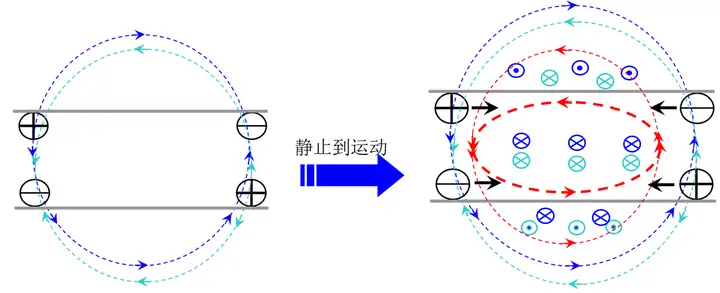   
>
> 假设导体中的两对电荷(模拟信号路径和返回路径),蓝线是上导体中电荷对的电场线、绿线是下导体电荷对之间的电场线,静电场的叠加结果使得导体外和水平方向的电场因反向被弱化，两导体间异性电荷间的场因同向被加强(看图示的电场方向)，最终电场绝大部分分布在不同导体的异性电荷间。就是说上下导线的电场分布，总是在导线之间互相加强、而导线之外互相抵消，作用的综合结果是把电场约束在了两根导线之间。
>
> 上面右图，当导线上的电荷对因为相互吸引的作用力加速靠拢时，上面导线中有向右的电流、而下面导线中有向左的电流。这两根导线上的电流形成的感应磁场方向示意图如上，蓝色依然是上单体电流感应的磁场、绿色是下导体电流感应的磁场;从图示的方向可见，感应的磁场依然在两导体间同向加强，在导体外异向抵消，使得感应磁场的绝大部分依然分布在导体间。同时，红色线是为了
> 阻止电荷运动的感生电场方向，也是两个导线间加强、而导体外是抵消的趋势。
> 上下导体相互约束的结果，使得两导体上电荷复合感应的磁场都集中在两导体之间很小的区域内，与之相应的磁场能也集中在很小的区域内而不能扩散“稀释”;这样，不管静电势能还是感应场势能，都集中在导体间很小的区域，导体外侧基本没有场的存在，这正是传输线约束电磁场的原因。

# 传输线的信号路径和回流路径与参考平面    

**信号路径**:电流从电源（源端）出发，流向负载（接收端）的路径。在PCB上，这就是我们常说的“信号走线”    

**返回路径（Return Path）**：电流在负载端做功后，流回电源（源端）的路径。在传统电路中，这通常被称为“地线”（GND）

## 什么是参考平面    

首先这是一个完整的平面,以表层走线来说，走线和下面的平面层共同构成了电磁波传输的物理环境   如下是走线的横切面

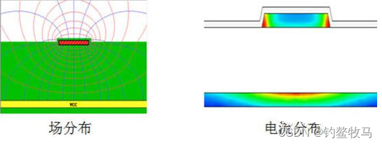

走线下面的平面到底是什么网络属性无所谓，VCC、GND、甚至是没有网络的孤立铜皮，都可以构成这样的电磁波传输环境，关键在于下面的平面是导体就行了。信号路径是表层走线，所以下面的平面就是参考路径。对于PCB上这一特殊结构，参考路径是以平面的形式出现的，所以也叫参考平面。从电流回路的角度来说，参考平面承载着信号的返回电流，所以也叫返回平面。上面面的图显示了表层走线的场分布和电流分布。

综上可知,**参考平面就是高速信号在PCB上传输时，紧贴在它旁边、为它提供电压基准和电流回流路径的完整大面积铜皮**,作为电磁波传输物理环境的一部分（从电磁波传输角度）、作为电流返回路径（从电流回路角度）。简单点说，参考平面两个点：算阻抗和提供回流路径。所以如果只是单纯的满足阻抗一致要求，无论是GND平面还是电源平面都是可以的。但是一般情况下，参考平面主要是作为电流返回的路径

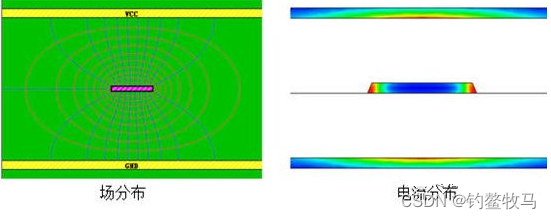

以内层走线来说，走线、上方平面、下方平面3者共同构成了电磁波传输的物理环境，所以上下两个平面都是信号的参考路径，也就是参考平面，从上面的场分布图中可以很清楚的看到物理环境和场分布的关系。从构成电流回路的角度来看，下图的电流分布图也很清晰的显示出返回电流的分布，如果两个平面和走线之间的间距近似相等，那么两个平面上的返回电流也近似相等，此时，两个平面同样重要。从这个角度也能很好的理解两个平面都是参考平面。

## 信号如何参考平面   

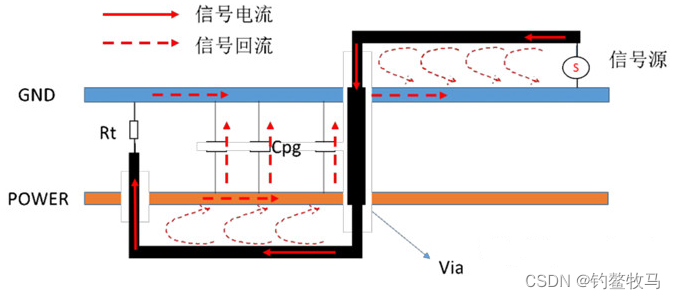

信号源以地平面作为参考平面(因为负端在地平面,所有返回电流都要从地平面流回电源负端)，回流路径当然是地平面，当高速信号在信号线上传播时，在信号电流向前传播的过程当中，由于与参考平面之间存在容性耦合(就是寄生参数)，所以当发生dV/dt时，就会有电流经耦合电容流向参考平面的现象，传输线正下方位置都会有瞬态电流(就是感应电流)流回到源端电路。

经过过孔VIA,**交流信号**的参考为电源平面

> 直流信号不会产生感应电流,返回路径就是直流路径始终是地平面,也就是说直流信号的参考平面不会变

那么信号回流将首先流向电源层，然后再通过电源与地网络之间的Cpg(Cpg电源与地网络之间的容性通道。它可以是电源地网络上分布复杂的退耦电容，也可能包含电源地层平面之间的平板电容)流向地网络，最后再经地层流向源端电路，最终形成一个完整的电流回路。   

> 为什么会从电源平面产生感应电流流回信号源负端呢?这涉及到一个重要的东西,高频信号总是沿则感抗最小的回路路径传输    
> 因为任意一个电路回路中有变化的磁通量穿过时，将会在环路内感应出电流。电流的大小与磁通量成正比。较小的环路中通过的磁通量也较少，因此感应出的电流也较小，这就说明环路面积必须最小
> $$
> L = \frac{\Psi}{I}\\   
> \Psi = B \cdot S
> $$
> 由上述两个公式可知,单电流固定时,磁通量越小L越小,因为L与回路面积成正比,所以环路面积越小,电感越小    
>
> 环路要有最小的面积通常来说,回流路径就是信号路径在参考平面的投影    
>
> 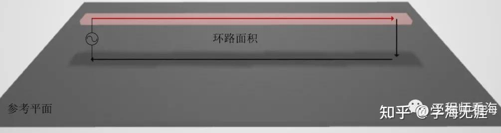
>
> 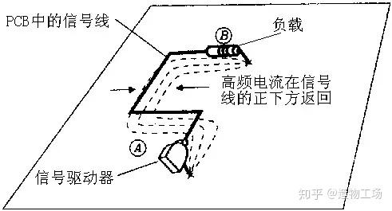
>
> 此时回到,为什么要走电源平面这个问题上,因为此时由于退耦电容的存在,在交流信号看来,电源平面和地平面是接近等电势的,那么可以看成负载的负端也是和电源层连接的,由刚才所说,交流信号会选择感抗最小的回路,那么在电源层上就先出现回流电流通过退耦电容返回到信号源负端

我们都知道，控制好高速信号的回路阻抗非常关键，因为它直接影响到信号传输特性。

这里刚好涉及到三个知识点，可能大家平常没有注意：

1、高速信号换层需要加回流地过孔，这里其实就是增加了垂直方向的回流路径，这个对于高速信号是非常有必要的。

2、高速信号换层后尽量还是同类型的参考平面，

3、当电源、地层之间存在足够的去耦电容后，其交流阻抗极小，交流信号可以在任何一层上传输。换言之，对于交流信号而言，在添加了足够的去耦电容后,阻抗小到可以认为电源和地层是等电位的.

# 传输线上的相互干扰

在得到传输线的等效模型后就可以对传输线上的干扰进行分析

这种干扰是由于两条信号线之间的耦合，即信号线之间的互感和互容耦合引起的，容性耦合引发耦合电流，而感性耦合则引发耦合电压。容性耦合是由于干扰源上的电压变化在被干扰对象上引起感应电流从而导致的电磁干扰，而感性耦合则是由于干扰源上的电流变化产生的磁场在被干扰对象上引起感应电压从而导致的电磁干扰。因此，信号在通过一导体时会在相邻的导体上引起两类不同的噪声信号：容性耦合信号和感性耦合信号

# 设计良好信号完整性的指标方法   

1、利用PCB板的参考层控制信号的回流电流，控制EMI，稳定走线阻抗，控制串扰，对电源系统进行高频去耦   

2、减小走线和参考层之间的距离，减小EMI，减小串扰     

3、减小电路板上的电感效应，焊盘，过控，电源层和地层     

 # 参考文献   

[(3 封私信 / 6 条消息) 大道至简 | 传输线这样学很简单 - 知乎](https://zhuanlan.zhihu.com/p/310164561)    

[(3 封私信 / 6 条消息) 电信号在传输线中是怎样传播？ - 知乎](https://www.zhihu.com/question/67157381)    

[硬件-射频学习DAY4——高频信号的高速公路：传输线原理全解析_第一页传输线物理本质**→ 承接:从电路理论过渡到分布参数系统- 动态对比:普通导-CSDN博客](https://blog.csdn.net/weixin_43260261/article/details/150391166)

[(3 封私信 / 6 条消息) 传输线理论、回流路径和延迟 - 知乎](https://zhuanlan.zhihu.com/p/644094212)

[(3 封私信 / 6 条消息) 导线为什么能够束缚住电磁波？电磁波具有能量，电磁波传播不需要介质，那导线的作用是什么？ - 知乎](https://www.zhihu.com/question/263536553)

[(3 封私信 / 6 条消息) 高频电信号是电磁波吗？如果不是如何解释传输线理论? - 知乎](https://www.zhihu.com/question/429109229)

[(3 封私信 / 6 条消息) 电信号究竟是如何在传输线中传输的 - 知乎](https://zhuanlan.zhihu.com/p/35606675)

[史上最透彻讲解：伟大且完美的麦克斯韦方程组](https://www.zhihu.com/tardis/zm/art/580205680)

[(3 封私信 / 6 条消息) 电感基础1——为什么把‘线’绕成‘圈’就是电感？什么是电感？ - 知乎](https://zhuanlan.zhihu.com/p/149748238)

[寄生电感解析-CSDN博客](https://blog.csdn.net/weixin_42005993/article/details/108017483#:~:text=当导线电流变化时，这个磁场也会变化，变化的磁场会产生电场，这个电场将阻碍电流的变化，而阻碍电流变化的这种能力，就可以理解为电感，因为导线是回路的一部分，所以这部分电感称之为 局部电感。,实际上前面所说的回路的总体电感，应是整个回路所有导线相加所得的结果。 上图来源于《信号完整性与电源完整性分析-第二版》。 本来写到这里，也差不多能扯明白寄生电感，直导线电感怎么来的。)

[(3 封私信 / 6 条消息) 电流的磁场及磁场方向及安培右手定则讲解 - 知乎](https://zhuanlan.zhihu.com/p/455287482)

[(3 封私信 / 6 条消息) 大学物理知识点与公式-电磁学(全) - 知乎](https://zhuanlan.zhihu.com/p/668376302)

[传输线理论基础01——相关定义、信号速率、分布参数与电报方程_传输信号频率与导体的关系公式-CSDN博客](https://blog.csdn.net/weixin_42837669/article/details/128087955)

[PCB高速信号设计从信号完整性到传输线理论基础-电子工程专辑](https://www.eet-china.com/mp/a483983.html)

[(3 封私信 / 10 条消息) 高频电信号是电磁波吗？如果不是如何解释传输线理论? - 知乎](https://www.zhihu.com/question/429109229)

[(3 封私信 / 14 条消息) 拓展【电磁学】·无限长的直圆柱形载流导线内外的磁感应强度 - 知乎](https://zhuanlan.zhihu.com/p/625377804)
