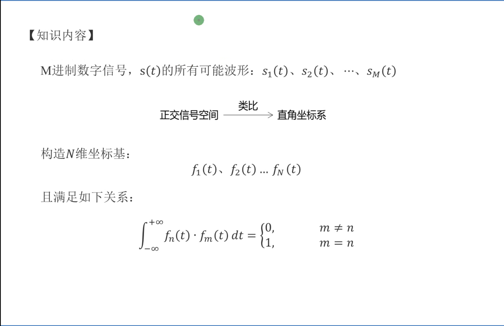
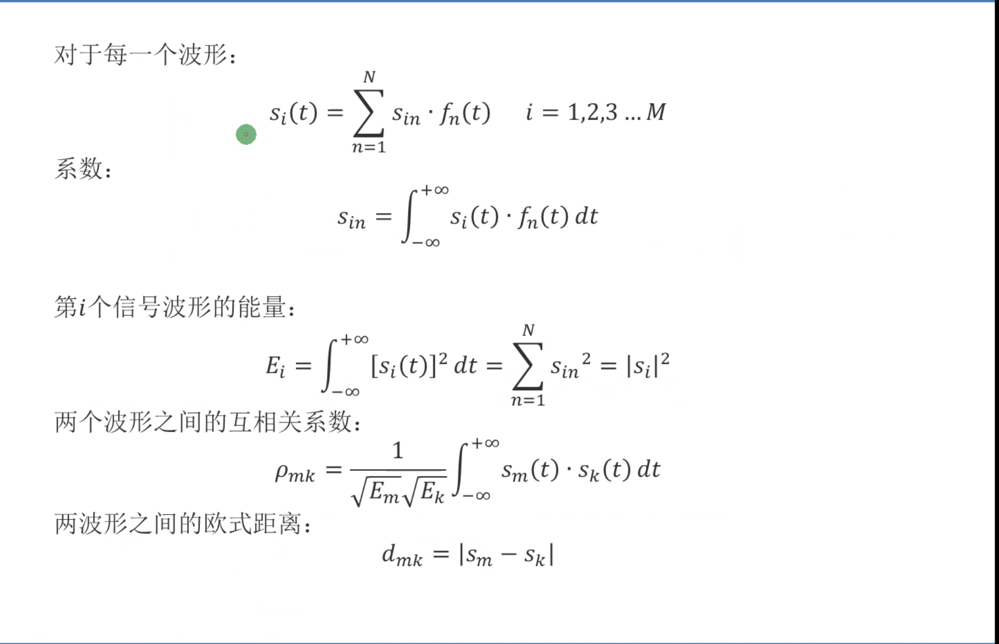
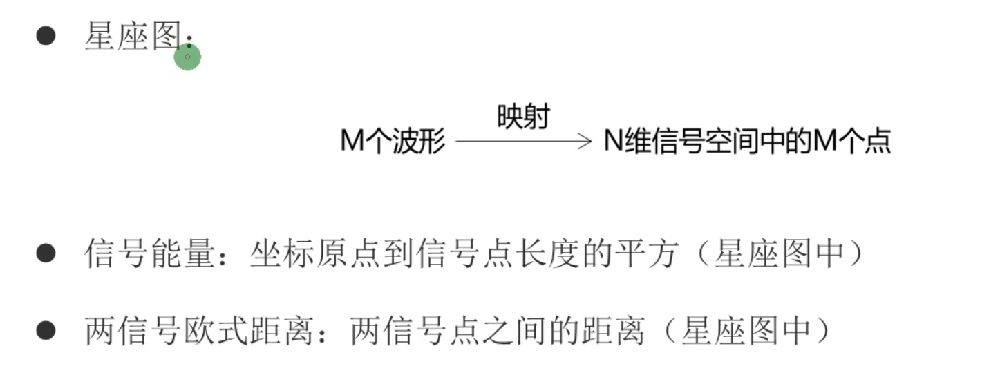

#  正交信号空间   

正交信号空间中信号可以类比于向量      

正交信号就是正交向量    

正交信号满足：∫x(t)y(t)dt=0      

正交向量基：就是在满足正交信号的情况下，∫x(t)x(t)dt=1        

对于星座图

假设一个二维的正交坐标基    

横坐标表示几个f1,纵坐标表示几个f2,   

比如

S1 = 2f1 + 3f2      

S2 = 3f1 + 2f2        

f1和f2就类似于x1和y1的向量

