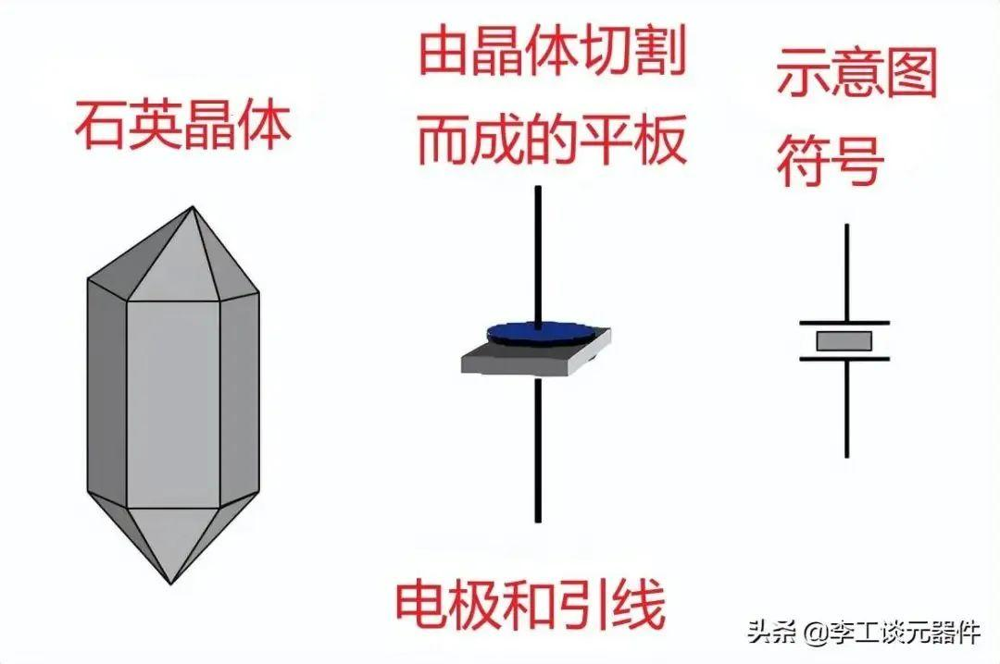
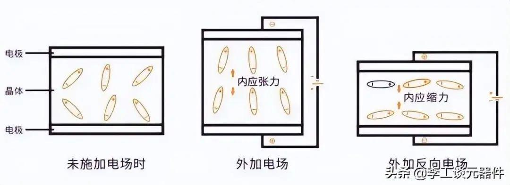
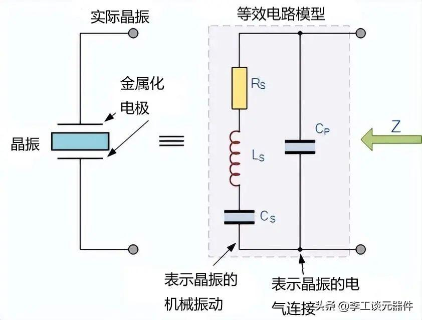
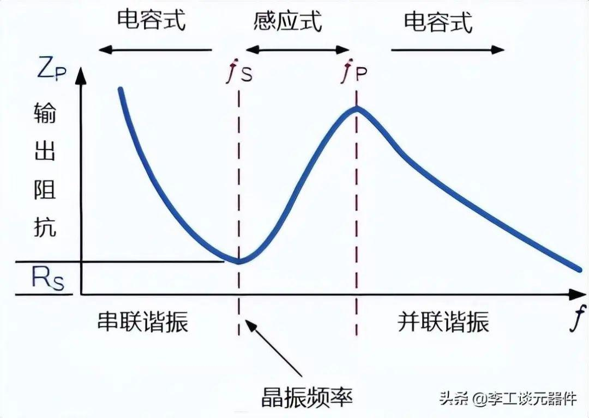

# 晶振   

由图可以看出,所谓的石英晶振就是用电容器将石英包裹起来   

## 晶振的工作原理 -压电效应

压电效应：若在石英晶体的两个电极上加上一电场，晶片就会产生机械变形。反之，若在晶片的两侧施加机械压力，则在晶片相应的方向上将产生电场，这种物理现象称为压电效应。   

石英晶体振荡器是利用石英晶体的压电效应制成的一种谐振器件，它的基本构成大致是：从一块石英晶体上按一定方位角切下薄片，在它的两个对应面上涂敷银层作为电极，在每个电极上各焊一根引线接到管脚上，再加上封装外壳就构成了石英晶体谐振器，简称为石英晶体或晶体、晶振。其产品一般用金属外壳封装，也有用玻璃壳、陶瓷或塑料封装的

在一般情况下，晶片机械振动的振幅和交变电场的振幅非常微小，但当外加交变电压的频率为某一特定值(即到达固有频率)时，振幅明显加大，比其他频率下的振幅大得多，这种现象称为压电谐振，它与LC回路的谐振现象十分相似
石英晶振电路本身是可以等效为一个LC振荡电路,
当晶体不振动时，可把它看成一个平板电容称为静电电容C，它的大小与晶片的几何尺寸、电极面积有关，一般约几个皮法到几十皮法。当晶体振荡时，机械振动的惯性可用电感L来等效。

石英晶体的等效电路显示了一个串联RLC电路，它表示晶体的机械振动，与一个电容Cp并联，它表示与晶体的电气连接，石英晶体振荡器倾向于朝着它们的“串联谐振”运行

晶体的等效阻抗具有串联谐振，其中Cs在晶体工作频率下与电感Ls谐振。该频率称为晶体系列频率ƒs。除了这个串联频率之外，当Ls和Cs与并联电容器Cp谐振时产生[并联谐振]，如下图所示，还建立了第二个频率点

## 晶振在原理图上的应用   

第 1 步：上电瞬间
MCU 内部反相器开始工作，产生微弱的噪声电信号。这个信号里什么频率都有，很乱。

第 2 步：晶振开始 “选频”
杂乱信号流过石英晶振：

只有晶振本身的谐振频率（比如 8MHz）能轻松通过
其他频率全部被晶振 “挡住”、衰减掉
👉 晶振在这里就是一个超级精准的频率过滤器。

第 3 步：反相器放大 + 正反馈 → 持续振荡
微弱的 8MHz 信号 → 进入反相器放大
放大后的信号 → 再次送回晶振
晶振再提纯 → 再放大 → 再送回……
形成闭环正反馈。

只要不断电，这个过程就一直循环。

电路就从 “杂乱噪声” 变成：稳定、持续、单一频率的正弦振荡信号。

第 4 步：内部整形 → 方波时钟
MCU 内部会把正弦波整形成**方波**。最终输出：**干净、稳定、精准的时钟脉冲**给 PLL、CPU、外设当基准时钟

两个小电容到底在干嘛？（新手必懂）
你原理图上 OSC_IN、OSC_OUT 到地的两个小电容（12pF/22pF），叫：负载电容（Load Capacitance）

它们的作用：

帮助起振保证上电就能震起来，不会 “震不起来”。
相位补偿让反馈回路满足振荡条件。
微调实际输出频率电容大小会轻微改变振荡频率，所以必须按晶振 datasheet 选值。
稳定频率减少温漂、干扰，让时钟更准。
👉 没有这两个电容：电路可能不起振，或频率不准、容易飘。

具体计算可以参考这个([晶振工作原理及参数详解（最透彻） - 阳光&技术 - 博客园](https://www.cnblogs.com/sunshine-jackie/p/8137293.html))
